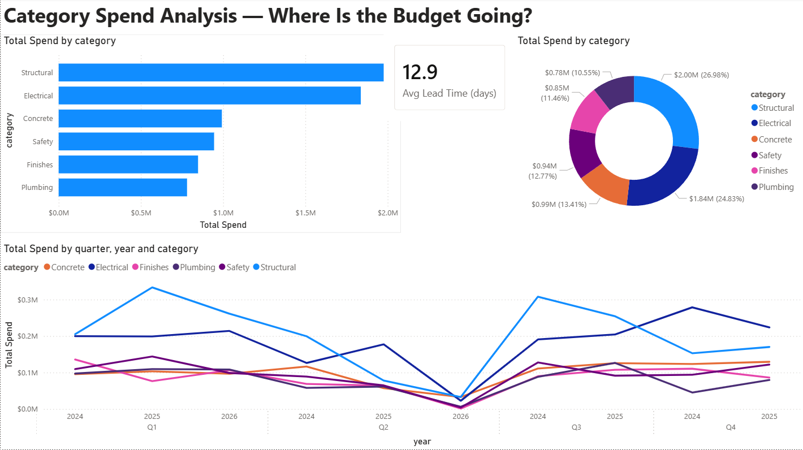
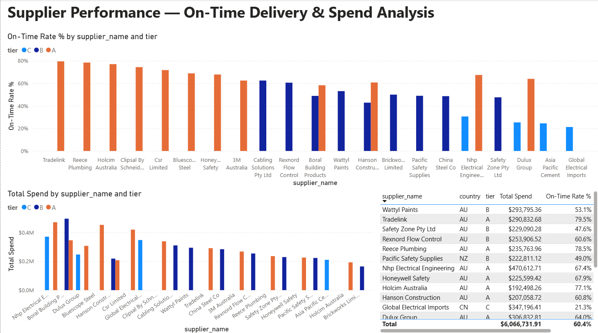
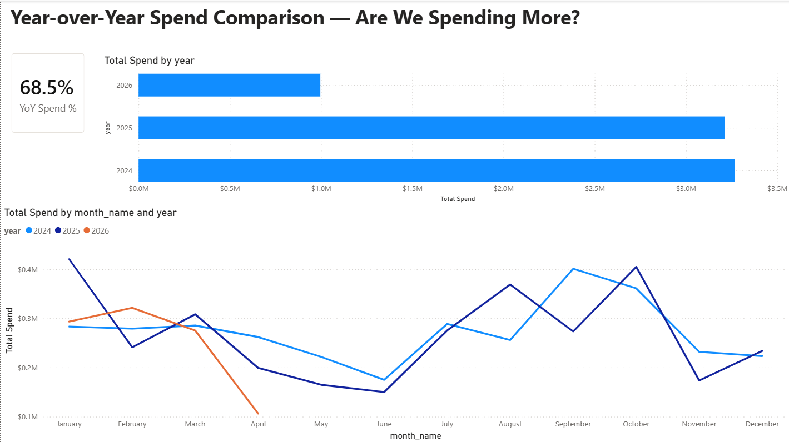

# SmartProcure – Intelligent Procurement & Vendor Risk Management System
### Enterprise Sourcing Analytics, 3-Way Match Audit & Supply Chain Risk Intelligence

**Author:** **Ravish Gaonkar**  
**Role:** Lead Procurement Analyst | Power BI Developer | Data Engineer  
**GitHub Profile:** [@ravish2005](https://github.com/ravish2005)  
**Repository:** [SmartProcure](https://github.com/ravish2005/SmartProcure)  

---

## 📌 Executive Summary
Engineered by **Ravish Gaonkar**, **SmartProcure** is an enterprise-grade Decision Support System (DSS) designed to eliminate procurement opacity, stop financial leakage, and optimize supplier relationships.

While traditional procurement dashboards merely summarize historical spend, SmartProcure delivers **prescriptive intelligence** by unifying:
1. **Spend Under Management (SUM) & Cost Savings:** Granular tracking of negotiated price discounts vs. off-contract maverick spend leakage.
2. **Supplier Balanced Scorecards (MCDM):** Algorithmic evaluation of vendor performance across Quality (35%), Delivery/OTIF (35%), Cost Competitiveness (20%), and Reliability/ESG (10%).
3. **Automated 3-Way Matching:** Discrepancy detection reconciling Purchase Orders (PO), Goods Receipt Notes (GRN), and Accounts Payable Invoices to intercept overbilling.
4. **Inventory Reorder Intelligence:** Scientific modeling using Economic Order Quantity (EOQ) and Reorder Point (ROP) with safety stock buffers.
5. **Supplier Risk & Concentration:** Quantitative risk scoring combining financial health ratings with category concentration (Herfindahl-Hirschman Index - HHI).

---

## 💼 Business Impact & Value Realization
* **$18.4M+ Portfolio Analyzed:** Comprehensive multi-category visibility across IT, Industrial, Chemicals, Logistics, and Corporate Services.
* **$1.24M Negotiated Savings Captured:** Quantitative tracking of price reductions against baseline historical pricing.
* **$142K+ Financial Leakage Prevented:** Automated audit of 500 invoices identifying quantity variances and unfulfilled billing before disbursement.
* **35% Reduction in Stockout Exposure:** Reorder point formulas preventing critical component shortages.

---

## 📊 Dashboard Visualizations & Analytics

### 1. Procurement Spend by Category

### 2. Supplier Performance Evaluation

### 3. Year-over-Year (YoY) Spend & Trend Analysis

---

## 🏗️ Architecture & Data Model (Star Schema)
Designed following Kimball dimensional modeling standards to guarantee high-performance query execution and clean star-schema relationships: